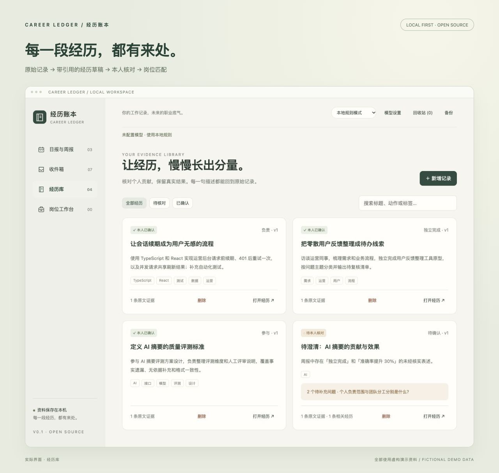
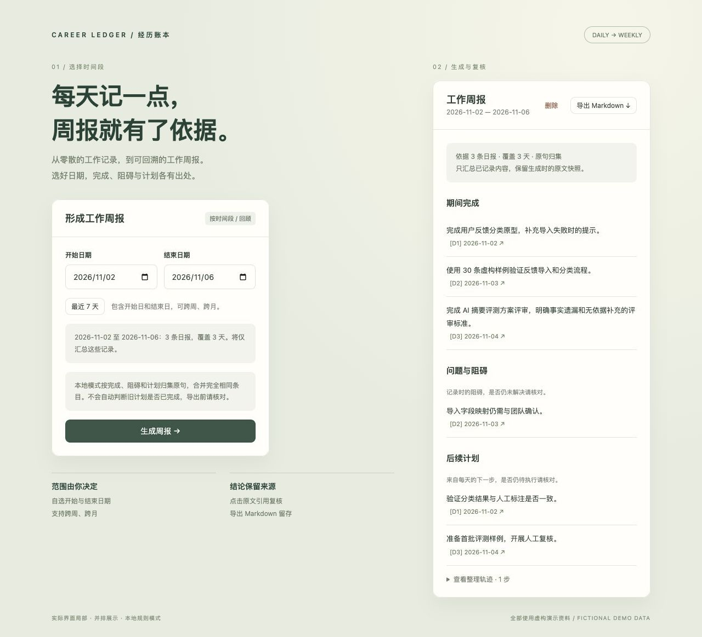

<div align="center">

# 经历账本 · Career Ledger

**把今天的工作，变成明天有据可查的经历。**

A local-first career evidence agent. Turn work notes into reviewed experience cards and job-specific, source-linked resume drafts.

[](https://github.com/jeremy-nbd/career-ledger/actions/workflows/test.yml)


[开始使用](#快速开始) · [技术路线](#技术路线) · [模型接入](#可选连接模型-agent) · [架构](docs/architecture.md) · [English](docs/README.en.md)

</div>

工作时留下周报、笔记和复盘；找机会时，知道哪些经历可以支撑岗位要求，以及哪些问题还没有证据。

经历账本把这件事连接起来：

**原始记录 → 带引用的经历草稿 → 本人核对 → 岗位要求与证据对应 → Markdown 经历精选。**



## 一个具体例子

> “我参与 AI 摘要的评测方案设计，模型接口与调度由后端同事实现。目前只完成了方案评审。”

这段经历应保留“参与”“方案评审”和团队分工。它不能自动变成“独立搭建 AI 系统，准确率提升 30%”。

模型生成内容默认进入草稿。你在同一窗口对照原文、修订贡献与结果，再决定是否允许用于岗位分析。引用会逐字校验，但**引用存在不等于结论正确**，仍需本人核对。

## 第一版可以做什么

- **收件箱**：粘贴记录或导入 `.md` / `.txt`；相同原文按内容去重；模型失败时原始记录仍保留。
- **日报与周报**：每天记录完成事项、问题阻碍与下一步；支持补记和同日追加。按自选开始日期和结束日期汇总成周报，每条内容关联日报原文，支持历史快照与 Markdown 导出。
- **经历库**：查看原文证据、补充问题、相关经历提示；编辑贡献与结果；保留最近 30 次修订。
- **岗位工作台**：粘贴 JD，关联已确认经历，区分直接证据、相邻线索和证据缺口。
- **证据导出**：生成 Markdown 经历精选与证据索引；导出采用确认后的措辞，不自动扩写成果。
- **历史快照**：每次岗位分析保存当时的经历与原文，后续修订不会改变旧导出。
- **本地备份**：一键下载完整账本 JSON。
- **删除与恢复**：日报、原始记录、经历卡片、周报和岗位分析均可移入回收站，再按需恢复。
- **无密钥体验**：内置虚构人物“林舟”的 4 条记录与 2 份 JD，包括贡献冲突、尚未上线和未核实数字。

## 技术路线

项目采用 **本地优先存储 + 规则处理与模型处理双模式 + 工具调用 Agent + 证据校验 + 人工确认** 的实现路线。先保存原始材料，再按任务读取和整理；模型负责归纳与提出建议，程序负责引用校验、状态流转和持久化。

### 技术栈与分层

| 层次 | 当前实现 | 职责与代码入口 |
| --- | --- | --- |
| 界面 | 原生 HTML / CSS / JavaScript、ES Modules | 日报录入、日期范围选择、原文核对与报告展示；`public/` |
| HTTP 服务 | Python 标准库 `http.server` | 提供 JSON API 和静态文件，处理本机访问限制；`career_ledger/server.py` |
| 领域逻辑 | Python 确定性函数 | 内容去重、日期筛选、引用校验、本地整理与 Markdown 导出；`career_ledger/domain.py` |
| Agent | Python `urllib.request` + Chat Completions 兼容接口 | 定义工具、执行模型请求循环、回传校验错误；`career_ledger/agent.py` |
| 数据存储 | 本地 JSON 文件 + 进程内串行写入 + 临时文件替换 | 保存原文、经历、报告和修订历史；`career_ledger/store.py` |
| 删除恢复 | 软删除标记与删除批次 | 处理来源与经历的关联删除、恢复；`career_ledger/trash.py` |
| 验证 | `unittest` + GitHub Actions | 领域测试、模拟模型工具调用、HTTP 集成测试；CI 覆盖 Python 3.9 / 3.12 / 3.14 |

当前无运行时第三方依赖，也没有前端构建步骤，方便本机启动与阅读源码。存储面向单人、单进程使用；尚未接入数据库、向量检索或多 Agent 编排框架。

### Agent 如何完成任务

1. **限定输入和工具**：服务端根据任务选择工具集。经历整理围绕当前原文进行，岗位分析检索已确认经历；周报先按起止日期筛选日报，并将这些记录作为本次任务的输入快照。
2. **模型选择工具**：模型通过 `tool_calls` 请求读取原文或检索经历。经历检索目前采用文本子串匹配，每次最多返回 30 条卡片及其引用。
3. **程序执行并返回结果**：服务端执行允许的工具，将结果作为工具消息交回模型，模型据此继续调查或提交结构化结果。
4. **校验与修正**：`finish_card`、`finish_match`、`finish_weekly` 的结果经过领域校验，检查原文引用、来源 ID、JD 原句及经历确认状态等。工具参数或结果不合格时，错误返回模型供下一轮修正。
5. **保存与人工复核**：通过校验的经历进入草稿，需本人确认后才能用于岗位分析；周报与岗位分析保存生成时的证据快照，供复核和导出。每次任务最多请求模型 7 轮，网络读写超时为 45 秒。

这套流程中的 Agent 是一个按任务配置工具的调用循环。它可以读取、检索和提交建议，但不能直接确认经历、执行任意代码或自动投递简历。逐字引用校验只能证明引文存在，结论是否受到引文支持仍需人工判断。

### 数据与模型的边界

- **先落盘再整理**：记录按 SHA-256 内容哈希去重；日报哈希包含日期。同日可以追加不同内容，模型调用失败不会丢失已保存原文。
- **日期筛选由程序完成**：周报包含开始日与结束日，仅将范围内未删除的日报交给整理逻辑；模型不负责决定哪些日期入选。
- **本地模式可独立使用**：通过原句归集、标签与关键词规则生成结果；模型模式由用户主动选择，调用失败会明确报错，不会静默切换为本地结果。
- **报告保存历史快照**：后续修订或删除当前材料，不会改写旧报告中的证据；经历更新使用修订号检查，避免旧页面覆盖新修改。
- **密钥留在服务端**：账本默认保存到 `data/ledger.json`，模型配置来自 `.env`。只有选择模型模式时，任务所需材料才会发送到配置的模型服务。

更完整的数据结构、校验规则和部署边界见 [架构说明](docs/architecture.md)。

## 快速开始

需要 **Python 3.9 或更新版本**。无运行时依赖，无需安装数据库或执行构建。

```bash
git clone https://github.com/jeremy-nbd/career-ledger.git
cd career-ledger
python3 -m career_ledger
```

打开 **http://127.0.0.1:4317**。

第一次使用可以选择：

1. 点击「体验虚构示例」，查看卡片与待核对问题；
2. 或直接粘贴自己的工作记录，点击「保存并整理」；
3. 在经历库核对贡献和结果，勾选本人确认；
4. 在岗位工作台粘贴 JD，分析并导出 Markdown。

演示只允许载入空账本，避免混入现有资料。若要单独体验示例，可用独立数据目录启动：

```bash
CAREER_DATA_DIR=./data/demo python3 -m career_ledger
```

日常账本仍使用默认的 `data/ledger.json`。同一数据目录只运行一个服务进程。Python 服务会获取数据目录进程锁。

从旧版升级时，先停止原有 Node.js 服务并备份账本，再执行上述 Python 启动命令。Python 版直接读取原有 `.env` 和 version-1 `ledger.json`，保留日报、经历修订、回收站及报告快照。Windows 可将命令中的 `python3` 替换为 `python`。

## 两种模式，明确区分

| 能力 | 本地规则模式 | 模型 Agent 模式 |
| --- | --- | --- |
| 模型调用 | 无 | 你配置的兼容服务 |
| 整理记录 | 原文摘录、固定追问 | Agent 读取原文、检索经历、生成草稿与追问 |
| 相关经历 | 显式标签重叠 | 模型选择检索词，查看卡片后提出关联 |
| 岗位匹配 | 关键词线索；只标相邻或缺口 | 基于职责与证据提出匹配判断 |
| 周报生成 | 按板块归集原句，合并完全相同条目 | 归纳主题、合并重复事项，引用所选时间段的日报 |
| 核对方式 | 本人对照原文确认 | 同样需要本人确认 |

**本地规则模式不理解完整职责、不验证年限，也不输出“匹配分数”。** 模型模式也不预测录用概率。

## 每天记日报，到周末生成周报

1. 打开「日报与周报」，选择日期，填写完成事项、问题阻碍和下一步；每行可记录一件事。
2. 保存日报。日报只写入本机，也会出现在收件箱，可继续整理成经历卡片。
3. 选择「开始日期」和「结束日期」，核对将纳入的日报数量，点击「生成周报」。包含开始日和结束日，支持单日、跨周、跨月及跨年；「最近 7 天」只是快捷填入日期，不会限制自定义范围。
4. 核对期间完成、问题阻碍和后续计划，点击 `[D1]` 等引用查看当时的日报原文。
5. 导出 Markdown；周报历史保留生成时的数据快照，新补记的日报不会改变旧版本，可重新生成。

本地模式只合并完全相同条目，不能判断周一的计划是否已在周三完成，也不会把历史阻碍自动标为未解决。界面会提示你核对这些状态。模型模式可按时间顺序归纳，但同样需要复核。没有记录的日期不会被编造补齐。



单次周报支持最多 30 条日报、合计 60,000 字符；保留最近 100 份周报。日报没有静默覆盖接口，同日的新内容作为追加记录保存。

## 可选：连接模型 Agent

```bash
cp .env.example .env
```

填写 `.env`：

```dotenv
LLM_BASE_URL=https://your-provider.example/v1
LLM_API_KEY=your-key
LLM_MODEL=your-model
PORT=4317
```

地址填写到 API 前缀，服务会请求 `${LLM_BASE_URL}/chat/completions`。提供商需支持 Chat Completions、`tools` / `tool_calls`、`tool_choice: required` 和 `max_tokens`。本机模型允许 `http://127.0.0.1:…/v1`；远程模型使用 HTTPS。

重启服务后，在页面顶部切换「模型 Agent 模式」。**被 Agent 读取的原始记录、相关经历及 JD 会发送到你配置的模型服务**；本地模式不进行这些请求。模型密钥保留在服务端，不返回浏览器。

顶部会显示配置的模型名与当前模式；浏览器会记住你的模式选择，刷新后无需重新切换。「资料保存在本机」描述的是账本存储位置，不表示没有调用云端模型。

Agent 的工具只有：

| 工具 | 作用 |
| --- | --- |
| `read_source` | 读取原始工作记录 |
| `search_cards` | 查询既有经历，返回卡片及证据引用 |
| `finish_card` | 提交待核对草稿，不能直接确认或合并 |
| `finish_match` | 提交 JD 原句与已确认经历的对应关系 |
| `read_week_notes` | 只读取所选开始日到结束日之间的日报（包含首尾日期） |
| `finish_weekly` | 提交附有日报引用的周报，校验每条引文 |

每次任务最多 7 轮模型请求，网络读写超时为 45 秒。无效引用、虚构经历 ID 和缺失证据会返回模型修正；超过上限显式失败，不静默冒充成功。界面可查看工具执行摘要（不展示或存储模型私有推理）。

> 自动化测试通过模拟兼容接口验证工具调用、错误修正和失败恢复。迁移前的 JavaScript 后端于 2026-11-02 使用 `qwen3.5-plus` 和虚构记录实测通过了经历草稿链路（读取原文、提交草稿、引用校验）；岗位匹配与周报尚未进行该模型的真实接口验收。Python 后端已通过模拟接口回归验证，真实模型服务需单独验收。

## 本地资料与备份

各列表或报告详情中的「删除」会先弹出确认框，再将内容移到顶部「回收站」，不做永久清除。删除原始记录会同时移走引用它的使用中经历，确认框会显示受影响条目；恢复原文时会尝试一并恢复这些经历。单独删除经历不会删除原文。若经历引用的其他原文仍在回收站，需先恢复那些来源。

已删除内容不会参与新的草稿、岗位分析和周报生成；生成期间删除了所引用的内容，旧任务也不能把结果重新写回。已有报告保留自己的历史快照，因此仍可查看旧引用。若不需要历史报告，也可单独删除报告。备份包含回收站；此功能不等同于隐私数据的永久擦除。

- 默认数据：`data/ledger.json`，原文、卡片、修订与岗位分析保存在同一账本。
- `.env`、`data/` 和日志默认被 Git 忽略；仓库中的人物、公司、数据与 JD 均为虚构示例。
- 点击「备份」导出完整 JSON。恢复时停止服务，把备份复制为数据目录下的 `ledger.json`，再启动。恢复覆盖前保留原文件副本。
- 本机文件不是加密保险箱；能访问你的系统账号或文件的人可能读到它们。
- 服务仅监听 `127.0.0.1`，验证 Host/Origin，不提供云端账号系统。第一版用于单人本机使用，不能直接作为多人公网服务部署。
- 仅导出 Markdown 经历内容与证据索引，暂不包含完整简历排版、PDF、招聘网站抓取或自动投递。

## 开发与验证

```bash
python3 -m career_ledger
python3 -m compileall -q career_ledger
python3 -m unittest discover -s tests -v
```

测试覆盖原文去重、证据校验、贡献确认、修订冲突、不可变岗位快照、导出、并发保存、模型工具循环与失败恢复，以及日报去重、跨年日期范围、计划与成果分离和周报快照。所有模型测试使用模拟响应，不消耗 API 额度。集成测试需要允许进程绑定本机临时端口。

```text
career_ledger/
  agent.py       工具调用循环与兼容模型客户端
  domain.py      证据规则、本地模式、确定性导出
  server.py      HTTP API、本机访问限制
  store.py       串行写入与原子替换
public/          无构建步骤的中文界面
examples/        虚构经历与岗位
tests/           领域、Agent 与 HTTP 集成测试
docs/            设计说明、英文介绍与手动验收流程
```

## 接下来适合贡献什么

- 对比两条经历的差异，人工确认后关联或合并；
- 可配置的本地模型适配器和上下文预算；
- 引用精确到原文行号与段落；
- 面试追问练习与证据缺口提醒；
- 经审阅的简历句子改写建议及逐句 diff。

欢迎通过 Issue 讨论具体场景。提交问题时使用虚构或脱敏材料，参见 [贡献说明](CONTRIBUTING.md)。

## License

[MIT](LICENSE)
