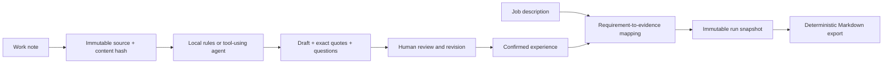

# Architecture and evidence boundaries

The app uses Python standard-library HTTP, filesystem, hashlib, urllib and unittest APIs. The UI is plain HTML/CSS/JavaScript. A small inspectable system makes the evidence and review boundaries easier to follow.

## Data flow

## Records

- `Source`: ID, original title/content, SHA-256 content hash, creation time. There is no source-edit endpoint; add a new source when original evidence changes.
- `Card`: title, personal action, outcome, contribution, tags, exact source quotes, open questions, related-card IDs, draft/confirmed state, revision, tool trace, and up to 30 previous revisions.
- `Run`: original JD, requirement mappings, execution mode, trace, immutable selected cards/sources, and exported Markdown. The most recent 50 runs are retained.
- Daily entries are `Source` records with `kind: daily`, a validated calendar date, and separate completed/blockers/next fields. The date is part of their content hash. Same-day additions preserve earlier entries.
- `WeeklyReport`: inclusive user-selected start/end dates, three sections with exact source quotations, immutable daily source snapshots, mode, trace and Markdown. The most recent 100 reports are retained. Reading a pre-journal version-1 ledger initializes the missing `weeklyReports` array without changing existing records.

The MVP allows 500 source records. Source input is limited to 40,000 characters; JD input to 20,000. Imported files are limited to 200 KB. Local draft mode takes an excerpt up to 2,400 characters, while preserving the complete original source. Agent search returns at most 30 cards per query. These are practical MVP bounds, not a long-document retrieval system.

## Reversible deletion

`trash.py` sets `deletedAt` and a `deletionBatch` on records in their original collections. `/api/state` exposes only active records plus a metadata-only Trash listing; `/api/backup` preserves all data. Existing version-1 ledgers need no migration. The source limit counts active sources.

Deleting a source cascades to active cards referencing it. Restoring a source only auto-restores cards from that same deletion batch whose sources are all active. It does not revive cards previously deleted on their own. Restoring a source conflicts if an identical active source has been reimported. Card delete/restore increments the revision to reject stale edits.

Draft, match and weekly generation operate on active snapshots and recheck referenced records at commit time, so deleting a dependency in flight cannot write a new result. Historical reports carry their own snapshots and remain readable. Active report retention limits do not purge trashed reports. No permanent-delete endpoint is provided.

## What code enforces

- Source deduplication uses an exact content hash after outer whitespace trimming.
- Every quote is a contiguous exact substring of an existing source. Drafts must cite the current input source.
- Generated cards are always drafts. Confirmation requires an explicit contribution choice and a user action.
- Updates use optimistic revision checks and retain history.
- Model-generated job requirements must occur verbatim in the JD; card IDs must refer to confirmed cards. A direct/adjacent claim requires at least one card reference.
- Historical exports use snapshots, unaffected by later edits or withdrawals of current cards.
- Writes are serialized in process and persisted with a temporary file plus rename. A corrupted file causes an error instead of an automatic reset. A data-directory OS lock excludes other Python server processes. Stop legacy Node.js servers before migration because they do not acquire this lock.
- The agent can only read notes, search cards, and propose outputs; it cannot execute code, fetch arbitrary URLs, confirm cards, merge records, or contact recruiters.

## What code does not prove

An exact quote may still be irrelevant to a claim. A user may confirm an inaccurate statement. Tags can overlap without meaningful skill equivalence. The system does not prove truth, verify employment, determine candidate eligibility, or predict hiring outcomes. Model guidance helps preserve ownership and uncertainty, but is not a complete prompt-injection defense.

For this reason, the review UI shows original quotes next to editable claims, clearly labels self-confirmation, and does not let generated prose directly become a confirmed record.

## Model protocol

`CareerAgent.run` sends tool schemas through a Chat Completions-compatible endpoint. It requires investigation before accepting `finish_card` / `finish_match`, applies domain validators, returns validation errors as tool results, and ends after seven requests. Network I/O uses a 45-second socket timeout. In-flight runs are not persisted and do not survive process termination. Closing a browser tab does not cancel a running model request; the bounded server-side task may finish and save its result.

Only tool names and short operational summaries are retained. No private chain of thought is requested or stored. Provider bodies and secrets are omitted from application error responses.

Weekly tasks expose only `read_week_notes` and `finish_weekly`; the read tool is scoped to the selected range's immutable input snapshot. The API requires explicit start/end values and validates calendar dates and start <= end. Filtering uses inclusive ISO date comparisons without rounding to a week boundary; the browser defaults to the last seven days using UTC calendar arithmetic and local today. Existing reports retain their saved dates and snapshots. Generation is capped at 30 daily entries and 60,000 characters. Local generation merges identical lines within each section and retains all source IDs; it makes no semantic claim about whether old plans or blockers remain current.

## Local app boundary

The HTTP server binds to `127.0.0.1`. Host checks reject unrelated DNS names; Origin checks reject cross-origin requests; write endpoints accept JSON only. Static assets use an allowlist and a restrictive Content Security Policy. User text is HTML-escaped by the UI. API keys stay on the server.

These controls do not protect against a compromised local account, a malicious browser extension, or another local process. A future hosted version needs authentication, tenant isolation, storage redesign, rate limiting and provider credential management.

## Python migration

Run `python3 -m career_ledger` from the repository root with Python 3.9+. The backend uses standard-library modules and preserves existing JSON API field names and version-1 ledger records. `tests/legacy.json` contains fictional outputs generated by the previous JavaScript backend, used to compare hashes, local analysis, weekly reports and Markdown exports. The frontend uses browser JavaScript modules. `.env` supports literal assignments, quoted values, comments and an optional `export` prefix. Existing environment variables take precedence.
